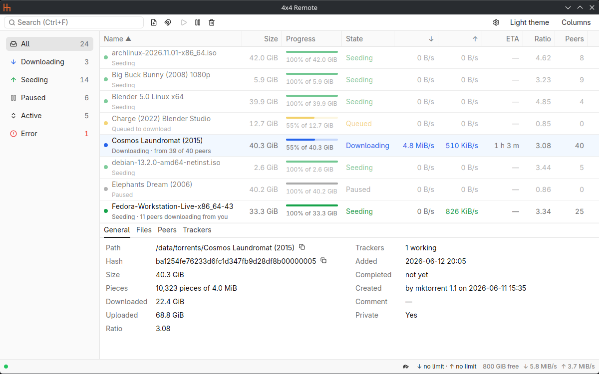
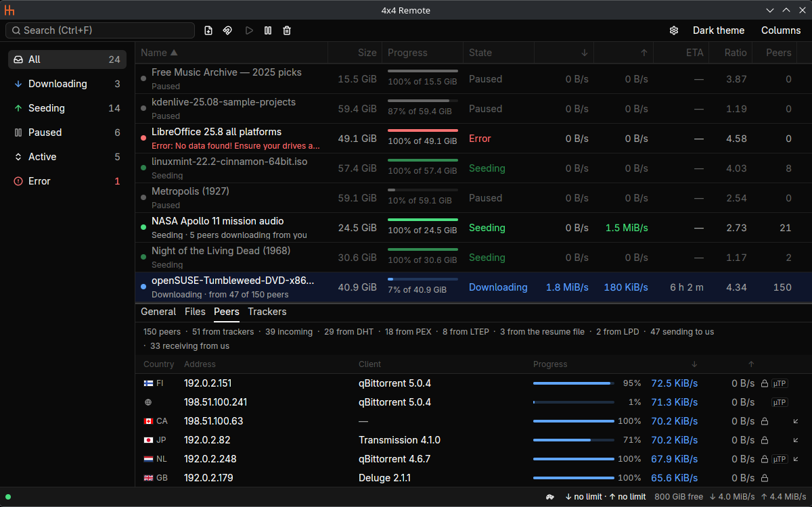

# 4x4 Remote

4x4 Remote (4x4 for short; its command is `4x4`) is a native desktop client for a remote
[Transmission](https://transmissionbt.com/) daemon, written in Rust.

<picture>
  <source media="(prefers-color-scheme: dark)" srcset="docs/images/main-dark.png">
  
</picture>

## Features

- Connects to a Transmission daemon by host, port and RPC path, with a user name and password when
  it asks for them, and switches to another daemon without a restart. It reconnects on its own,
  and while the daemon does not answer the last data stays on screen, dimmed.
- Shows every torrent in a table: a colored dot for its state, a progress bar, the size, the
  speeds, the time left, the share ratio and the peers. Idle torrents are dimmed, so the active
  ones stand out.
- Sorts by any column; shows, hides, reorders and resizes the columns.
- Filters by state from a sidebar with live counts, and searches by name.
- Starts, pauses, starts ahead of the queue, verifies and reannounces one or several torrents, from
  the keyboard, the toolbar and a context menu; copies their magnet links and info hashes.
- Removes torrents safely: removing from the list and removing with the files are separate
  commands, and deleting files always asks for an explicit confirmation.
- Shows the selected torrent in a details panel with four tabs: General; Files, a tree with each
  file's progress, Low, Normal and High priority, skipping files, downloading in order and how much
  of a file already plays from its start; Peers, with their country flags; and Trackers.
- Adds torrents from `.torrent` files (the desktop's file dialog, drag and drop, the command line)
  and from magnet links (the clipboard or a form), choosing the folder on the server, with its free
  space and the folders used lately, and the files to download.
- Opens `.torrent` files and `magnet:` links from file managers and browsers. One 4x4 runs for
  each user: starting it again hands the files and links to the one that runs.
- Shows the total speeds, the free space and the connection in a status bar; switches the
  alternative speed limits and sets the global download and upload limits.
- Follows the system's light or dark theme, or keeps the one you choose, and remembers the window
  size, the columns, the sorting, the filter and the details panel between runs.
- Goes easy on a small server: it asks the daemon for updates every 1.5 seconds while the window
  has the focus and every 10 seconds while it does not, and reads a torrent's details only while
  they are shown. It is one native executable that draws through Vulkan
  ([measurements](docs/performance.md)).

## Requirements

- Transmission 4.1 or newer
- Linux (other platforms are not supported yet) with a Wayland or X11 session
- A Vulkan driver (for example `vulkan-radeon`, `vulkan-intel` or `nvidia-utils`). Without one,
  4x4 draws through OpenGL, which uses more memory.

## Limitations

- Only plain `http://` connections to the daemon; no HTTPS yet.
- Linux only, and packaged for Arch Linux only.
- English only, although every text of the interface is ready for translation.
- The country flags of the Peers tab need the GeoIP files of the `geoip-database` package, which the
  Arch Linux package depends on; without them the peers show no country.
- The password of the daemon is kept as plain text in `config.toml`, a file only you can read; 4x4
  uses no keyring.

## Install

On Arch Linux, 4x4 installs as the package `4x4-git`. Without a checkout of this repository, build
it from GitHub's `master` branch: download the build file into an empty directory and run `makepkg`
there (makepkg comes with pacman; the build also needs `base-devel`). `-s` installs the build
dependencies that are missing and `-i` installs the package once it is built; both ask for your
password through `sudo`.

```bash
mkdir 4x4-build && cd 4x4-build
curl -LO https://raw.githubusercontent.com/lexy898/4x4-remote/master/packaging/arch/PKGBUILD
makepkg -si
```

The package installs `/usr/bin/4x4`, its desktop file and its icon, so 4x4 Remote shows in the
application menu at once. It depends on `geoip-database`, whose country files give the peers their
flags. The first build takes several minutes. makepkg leaves its work in `4x4-build`: the clone of
the repository, the compiled crates (about 2 GiB, which make the next build faster) and the package
file. Cargo keeps the crates it downloads in `~/.cargo`.

To update, run the `curl` and `makepkg -si` above again in `4x4-build`: makepkg builds the newest
`master`, and pacman replaces the installed version.

To uninstall, run `sudo pacman -R 4x4-git`, and if you made 4x4 the default app for `.torrent`
files and magnet links (below), choose another app for them in your desktop's settings. Your
`config.toml`, `state.toml` and logs stay (see [Files and logs](#files-and-logs)), and the
`4x4-build` directory can be deleted.

4x4 offers itself to file managers and browsers as an app for `.torrent` files and magnet links,
but never makes itself their default. To open them with 4x4, in Dolphin and in a browser, choose
4x4 for them in your desktop's settings, or run once:

```bash
xdg-mime default io.github.lexy898.FourByFour.desktop \
    application/x-bittorrent x-scheme-handler/magnet
```

`xdg-mime` comes with the `xdg-utils` package and records the choice in `~/.config/mimeapps.list`.
A browser may ask once more the first time it meets a magnet link, offering 4x4 as the system
default.

4x4 is packaged for Arch Linux only. On another Linux system, build it from source, as
[Development](docs/development.md#build-from-source) describes (the package names there are those
of Arch Linux).

## First start

4x4 has no built-in server. The first time it starts, it asks nothing of any daemon, the status bar
says "No server set" and the Connection dialog opens. Fill in:

- Host: the name or the IP address of the machine the daemon runs on;
- Port: 9091 at first, Transmission's own;
- Path: `/transmission/rpc` at first;
- User name and Password, for a daemon that asks for a login; for one that does not, leave both
  empty.

A whole address pasted into Host, such as `http://nas:9091/transmission/rpc`, is spread over the
fields. Test asks the daemon for its version and says, in green, "Connected: Transmission 4.1.3
(…)", or in red why not, such as "The server rejected the credentials". If it says "The server does
not accept requests from this computer", add this computer's address to the daemon's RPC whitelist
(`rpc-whitelist`). Save, or `Enter`, writes the server to `config.toml` and connects at once;
Cancel or `Escape` changes nothing. Only plain `http://` works: an `https://` address is refused.

The gear button in the toolbar, `Ctrl+,` and a click on the connection dot in the status bar open
the dialog again; a server saved there takes over without a restart. The user name and the
password are kept in `config.toml` as plain text, in a file only you can read (mode 0600). The
[user guide](docs/user-guide.md#connection) has the details.

## Using 4x4

The window has five parts: a toolbar along the top, the filter sidebar on the left, the torrent
table, the details panel under the table and the status bar along the bottom.

- The table lists the torrents. Click a column header to sort by it, and again to reverse the
  order; drag a header to move its column, and its edge to resize it. "Columns" in the toolbar
  shows and hides columns.
- Click a row, or use the arrow keys, to select a torrent; Ctrl+click and Shift+click select
  several, and `Ctrl+A` selects every torrent the list shows.
- The sidebar shows All, Downloading, Seeding, Paused, Active or Error torrents, each with its
  count. The search box (`Ctrl+F`, or `/`) keeps the torrents whose names contain every word typed.
- The toolbar's buttons, a right-click on a torrent and the keys below start, pause, start ahead of
  the queue, verify, reannounce and remove the selected torrents, and copy their magnet links or
  hashes. Removing always asks first; to delete the files too, choose "Remove and delete files…",
  where only a click on "Delete files" deletes anything.
- The details panel (`Alt+Enter` shows and hides it) shows the selected torrent in four tabs,
  General, Files, Peers and Trackers (`Alt+1` to `Alt+4`). In the Files tab, the checkboxes skip
  files, a click on a priority changes it, and "Download in order (sequential)" downloads the
  torrent from its start.



- Add file (`Ctrl+O`) opens the desktop's file dialog for `.torrent` files, and Add magnet
  (`Ctrl+U`) takes the magnet links on the clipboard, or opens a form for one; `Ctrl+V` in the table
  and `.torrent` files dropped on the window add too. The add dialog then shows each torrent, with
  the folder on the server, the files to download and "Start immediately"; nothing is added until
  you press Add.
- The status bar shows the connection, the turtle that switches the alternative speed limits
  (`Ctrl+T`), the global speed limits, which a click or `Ctrl+L` sets, the free space and the total
  speeds.
- The theme button in the toolbar switches between the system's theme, light and dark.

`4x4 Show.torrent 'magnet:?xt=urn:btih:…'` offers those in the add dialog, as a file manager or a
browser opening them with 4x4 does. One 4x4 runs for each user: started again, it hands its files
and links to the one that runs and exits. `4x4 --version` prints the version, such as
`4x4 Remote 1.0.0`, and exits.

The [user guide](docs/user-guide.md) describes every part in full.

### Keys

| Key                                                 | Where                     | What it does                                 |
| --------------------------------------------------- | ------------------------- | -------------------------------------------- |
| `Ctrl+F`                                            | anywhere in the window    | moves to the search box and selects its text |
| `/`                                                 | anywhere but a text field | the same as `Ctrl+F`                         |
| `Escape`                                            | in the search box         | empties it and goes back to the table        |
| `Escape`, `Ctrl+Shift+A`                            | in the table              | clear the selection                          |
| `Up`, `Down`, `Page Up`, `Page Down`, `Home`, `End` | in the table              | select a torrent                             |
| `Shift+Up`, `Shift+Down`                            | in the table              | grow or shrink the selected range by a row   |
| `Shift+Home`, `Shift+End`                           | in the table              | stretch the selected range to either end     |
| `Ctrl+A`                                            | in the table              | selects every torrent the list shows         |
| `Ctrl+S`                                            | in the table              | starts the selected torrents                 |
| `Ctrl+P`                                            | in the table              | pauses the selected torrents                 |
| `Space`                                             | in the table              | pauses them if any runs, else starts them    |
| `Ctrl+Shift+S`                                      | in the table              | starts them now, ahead of the queue          |
| `Ctrl+Shift+R`                                      | in the table              | verifies their data                          |
| `Ctrl+R`                                            | in the table              | asks their trackers for more peers           |
| `Delete`                                            | in the table              | asks whether to remove them from the list    |
| `Shift+Delete`                                      | in the table              | asks whether to remove them with their files |
| `Ctrl+C`                                            | in the table              | copies their magnet links                    |
| `Ctrl+Shift+C`                                      | in the table              | copies their info hashes                     |
| `Up`, `Down`, `Enter`                               | in a menu                 | move to an item and choose it                |
| `Escape`                                            | in a menu                 | closes it                                    |
| `Enter`, `Space`                                    | in a removal dialog       | press the button that has the focus          |
| `Escape`                                            | in a removal dialog       | closes it and removes nothing                |
| `Ctrl+T`                                            | anywhere in the window    | switches the alternative speed limits        |
| `Ctrl+L`                                            | anywhere in the window    | opens the speed limits                       |
| `Alt+Enter`                                         | anywhere in the window    | shows or hides the details panel             |
| `Alt+1`, `Alt+2`, `Alt+3`, `Alt+4`                  | anywhere in the window    | show the panel's tabs in the bar's order     |
| `Ctrl+O`                                            | anywhere in the window    | opens the file dialog to add .torrent files  |
| `Ctrl+U`                                            | anywhere in the window    | adds the clipboard's magnet links, or a form |
| `Ctrl+,`                                            | anywhere in the window    | opens the Connection dialog                  |
| `Ctrl+V`                                            | in the table              | adds the magnet links on the clipboard       |
| `Up`, `Down`, `Page Up`, `Page Down`, `Home`, `End` | in the file list          | move between files and folders               |
| `Left`, `Right`                                     | in the file list          | close or open a folder, or go up or in       |
| `Space`                                             | in the file list          | downloads or skips the file or folder        |
| `+`, `-`                                            | in the file list          | raise or lower its priority                  |
| `Enter`                                             | in the speed limits       | applies them                                 |
| `Escape`                                            | in the speed limits       | closes them and changes nothing              |
| `Enter`                                             | in the add dialog         | adds it from a field, or presses the button  |
| `Escape`                                            | in the add dialog         | skips the torrent shown; adds nothing        |
| `Enter`                                             | in the Connection dialog  | saves from a field, or presses the button    |
| `Escape`                                            | in the Connection dialog  | closes it and changes nothing                |
| `Alt+Down`                                          | in the folder field       | opens the folders used lately                |
| `Tab`, `Shift+Tab`                                  | anywhere                  | move to the next or the previous control     |
| `Ctrl+Q`                                            | anywhere                  | quits 4x4                                    |

In the search box, `Ctrl+A` selects the text, not the torrents, `Ctrl+C` copies the selected text,
`Ctrl+V` pastes text, `Space` types a space, and `Delete` deletes a character, never a torrent.
`Ctrl+F` works on any keyboard layout. `/` is matched by the character the key types, not by its
place on the keyboard: on the Russian layout it is the key that types `/` there, not the key marked
`/`, which types a period. Verify is `Ctrl+Shift+R` rather than Transmission's `Ctrl+V`, which
adds magnet links here.

## Files and logs

4x4 keeps its files in the XDG directories (`$XDG_CONFIG_HOME` and `$XDG_STATE_HOME`, which default
to `~/.config` and `~/.local/state`):

| File                                | What it is                                                              |
| ----------------------------------- | ----------------------------------------------------------------------- |
| `~/.config/4x4/config.toml`         | The server. The Connection dialog writes it, readable by you only.      |
| `~/.local/state/4x4/state.toml`     | What 4x4 remembers between runs. It is safe to delete.                  |
| `~/.local/state/4x4/4x4.<date>.log` | The log, one file per day (UTC date); the last 7 daily files are kept.  |

`config.toml` holds the server, which the Connection dialog sets (see [First start](#first-start));
it can be written by hand too. Only plain `http://` is supported, and `username` and `password` are
only for a daemon that asks for a login (either one alone counts the other as empty):

```toml
[connection]
url = "http://192.168.1.10:9091/transmission/rpc"
username = "alice"
password = "secret"
```

The log lines also go to stderr. `RUST_LOG` sets the level for both (for example
`RUST_LOG=x4_app=debug`); without it 4x4 logs its own lifecycle events and the problems of its
libraries. If the log directory cannot be used, 4x4 logs to stderr only and still starts.

Between runs 4x4 remembers, in `state.toml`, the columns, the sorting, the filter, the theme, the
size of the window, the details panel and the last 10 folders torrents were added to. The
[user guide](docs/user-guide.md#files-and-logs) says how 4x4 writes these files, what it keeps
while it runs, and where it finds the GeoIP files.

## Documentation

- [User guide](docs/user-guide.md): every part of the window and its dialogs, what 4x4 remembers
  and the files it keeps.
- [Development](docs/development.md): building from source, packaging, debug builds, the
  architecture, the synthetic demo, the live tests and localization. [`AGENTS.md`](AGENTS.md)
  holds the rules every change follows.
- [Performance](docs/performance.md): how 4x4 is measured, and the figures of each stage.

## License

Licensed under either of [MIT](LICENSE-MIT) or [Apache-2.0](LICENSE-APACHE), at your option.

The country flags are the `3x2` pictures of
[country-flag-icons](https://gitlab.com/catamphetamine/country-flag-icons) 1.6.20, embedded as
published. They are MIT licensed, copyright (c) 2020 catamphetamine; their notice is in
[`crates/x4-app/assets/flags/LICENSE`](crates/x4-app/assets/flags/LICENSE).

This product includes GeoLite2 Data created by MaxMind, available from
<https://www.maxmind.com/>. (4x4 reads the country files of the `geoip-database` package to find
the countries of peers; it does not ship them.)
